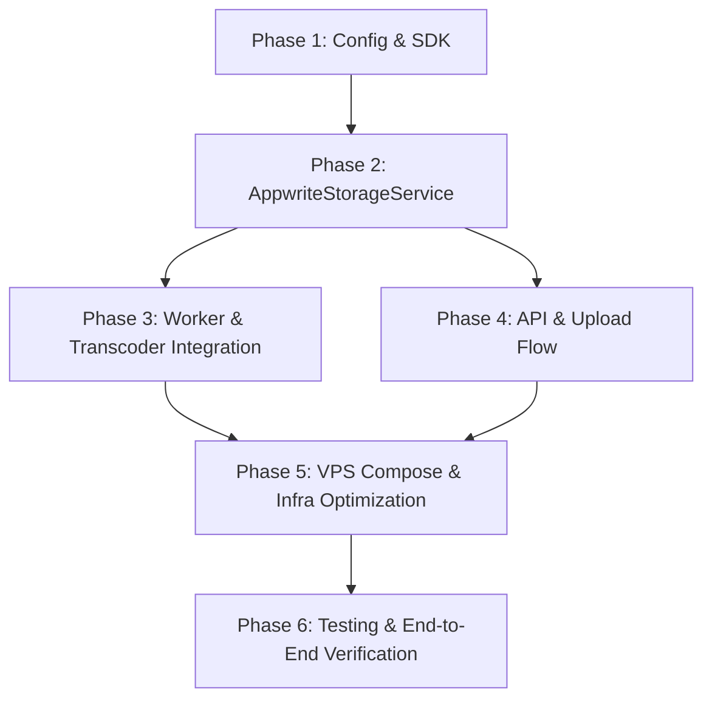

# Kế Hoạch Tích Hợp Appwrite Storage Vào Hệ Thống Feed.io

> **Mục tiêu:** Tích hợp **Appwrite Cloud Storage Pro** (`backend-storage-hub` / bucket `feedi-storage`) làm tầng lưu trữ đám mây cho Feed.io, giải phóng toàn bộ áp lực dung lượng ổ cứng (33GB SSD) và tài nguyên CPU/RAM của cụm Garage S3 self-hosted trên VPS `103.77.208.215`, đồng thời tận dụng CDN phân tán Frankfurt và tính năng tự động chuyển đổi ảnh WebP của Appwrite.
>
> **Nguồn cấu hình:** `/Users/nguyenkimquockhanh/Desktop/APPWRITE/.env.feedi`  
> **Ngày lập kế hoạch:** 15/10/2026

---

## 1. Hiện Trạng & Thách Thức Kỹ Thuật

| Thành phần | Hiện trạng (Garage S3) | Sau khi tích hợp (Appwrite Cloud Pro) |
| :--- | :--- | :--- |
| **Hạ tầng lưu trữ** | Chạy container `dxflrs/garage:v2.3.0` ngay trên VPS `103.77.208.215`. | Appwrite Cloud Pro Frankfurt (`https://fra.cloud.appwrite.io/v1`). |
| **Dung lượng & Băng thông** | Giới hạn bởi SSD VPS (33GB tổng thể cho cả OS, Docker, DB, S3). | **150 GB Storage** + **2.000 GB Băng thông CDN/tháng**. |
| **Giao thức tương tác** | Chuẩn AWS S3 qua thư viện `boto3` (Presigned PUT/GET URLs). | REST API / Python SDK (`appwrite`) & Web SDK / Direct CDN URLs. |
| **Giới hạn kích thước file** | Không giới hạn cứng (phụ thuộc cấu hình backend 1GB). | Cấu hình bucket hiện tại là **50 MB/file** (có thể mở rộng trên Console). |
| **Xử lý Thumbnail / Preview** | Worker FFmpeg render JPEG tĩnh, stream thẳng từ VPS. | Appwrite CDN hỗ trợ **tự động convert WebP, resize on-the-fly** (`output=webp`). |

---

## 2. Các Quyết Định Kiến Trúc Trọng Tâm (Architectural Decisions)

### 2.1. Triển khai theo Storage Adapter Pattern
* `feed.io` đã có sẵn abstraction rất sạch: `StorageService` protocol tại `apps/backend/src/feedio/modules/media/application/ports.py`.
* Tạo mới `AppwriteStorageService` tuân thủ 100% protocol này, song song với `S3StorageService`.
* Cung cấp biến môi trường `FEEDIO_STORAGE_PROVIDER`:
  * `"appwrite"`: Chế độ chính thức sử dụng Appwrite Cloud.
  * `"garage_s3"`: Giữ nguyên để phục vụ kiểm thử cục bộ hoặc fallback khi cần.
  * `"hybrid"`: Ảnh, thumbnail, proxy video và waveform lên Appwrite Cloud; file video gốc cực lớn (>50MB nếu chưa tăng limit) lưu qua S3.

### 2.2. Xử lý Giới hạn 50MB của Bucket `feedi-storage`
1. **Khuyến nghị chính (Nâng limit trên Appwrite Console):** Vì tài khoản là Appwrite Cloud Pro (GitHub Student Developer Pack), người dùng có thể vào [Appwrite Console - Bucket feedi-storage Settings](https://cloud.appwrite.io/console/project-backend-storage-hub) nâng `Max file size` từ `50MB` lên `500MB` hoặc `2GB` để hỗ trợ video gốc dung lượng lớn.
2. **Chiến lược xử lý mặc định:**
   * Thumbnail / Avatar / Covers (< 5MB): Upload trực tiếp vào Appwrite.
   * Audio Waveform JSON (< 1MB): Upload vào Appwrite.
   * Transcoded Web Proxy MP4: FFmpeg tối ưu độ phân giải 720p/1080p CRF 23, thường < 40MB với clip phổ thông.
   * Nếu file vượt quá 50MB mà chưa nâng limit: Hệ thống báo lỗi rõ ràng hoặc fallback sang storage dự phòng.

### 2.3. Quy tắc Đặt Mã File (Storage Key ↔ Appwrite File ID Mapping)
* Appwrite `file_id` quy định: **Tối đa 36 ký tự**, chỉ gồm chữ cái, số, dấu chấm `.`, gạch dưới `_`, gạch ngang `-`. Không được bắt đầu bằng ký tự đặc biệt.
* Feed.io sử dụng định dạng UUID v4 (đúng 36 ký tự) cho `media_id`.
* Quy tắc mapping chuẩn:
  * **File gốc (Original Media):** `file_id = str(media_id)` (VD: `550e8400-e29b-41d4-a716-446655440000`)
  * **Thumbnail:** `file_id = f"thumb_{media_id.hex[:30]}"` (VD: `thumb_550e8400e29b41d4a7164466554400`)
  * **Web Proxy Video:** `file_id = f"proxy_{media_id.hex[:30]}"`
  * **Waveform:** `file_id = f"wave_{media_id.hex[:31]}"`
  * **Filmstrip:** `file_id = f"strip_{media_id.hex[:30]}"`

### 2.4. Cơ chế URL Xem & Preview
* **Video/Audio Streaming:** URL trực tiếp qua Appwrite CDN:
  ```text
  https://fra.cloud.appwrite.io/v1/storage/buckets/feedi-storage/files/{file_id}/view?project=backend-storage-hub
  ```
* **Thumbnail / Poster / Image:** Tận dụng CDN Image Transformation:
  ```text
  https://fra.cloud.appwrite.io/v1/storage/buckets/feedi-storage/files/{file_id}/preview?project=backend-storage-hub&width=640&height=360&output=webp
  ```
* **Download:**
  ```text
  https://fra.cloud.appwrite.io/v1/storage/buckets/feedi-storage/files/{file_id}/download?project=backend-storage-hub
  ```
* **Bảo mật truy cập:** Cấu hình quyền `read("any")` trên bucket `feedi-storage` cho tài nguyên public/view, hoặc sử dụng Appwrite `Tokens` service (`create_file_token`) khi cần tạo URL có thời hạn cho private media.

---

## 3. Danh Sách Task Triển Khai Chi Tiết (Actionable Roadmap)



### Phase 1: Chuẩn Bị Cấu Hình & Thư Viện (Backend & Env)
- [x] **Task 1.1:** Cài đặt package `appwrite>=7.0.0` vào `apps/backend/pyproject.toml` và chạy `uv sync` trong `apps/backend` (đã cài `appwrite==25.0.0`).
- [x] **Task 1.2:** Bổ sung cấu hình Appwrite vào `apps/backend/src/feedio/bootstrap/config.py`:
  - `storage_provider: str = Field(default="appwrite", validation_alias=AliasChoices("FEEDIO_STORAGE_PROVIDER", "STORAGE_PROVIDER"))`
  - `appwrite_endpoint: str = Field(default="https://fra.cloud.appwrite.io/v1", validation_alias=AliasChoices("FEEDIO_APPWRITE_ENDPOINT", "APPWRITE_ENDPOINT"))`
  - `appwrite_project_id: str = Field(default="backend-storage-hub", validation_alias=AliasChoices("FEEDIO_APPWRITE_PROJECT_ID", "APPWRITE_PROJECT_ID"))`
  - `appwrite_bucket_id: str = Field(default="feedi-storage", validation_alias=AliasChoices("FEEDIO_APPWRITE_BUCKET_ID", "APPWRITE_BUCKET_ID"))`
  - `appwrite_api_key: str = Field(default="", validation_alias=AliasChoices("FEEDIO_APPWRITE_API_KEY", "APPWRITE_API_KEY"))`
- [x] **Task 1.3:** Cập nhật `.env.example` và `.env` của feed.io với các giá trị từ `/Users/nguyenkimquockhanh/Desktop/APPWRITE/.env.feedi`.

### Phase 2: Cài Đặt `AppwriteStorageService` (Core Storage Implementation)
- [x] **Task 2.1:** Tạo file `apps/backend/src/feedio/modules/media/infrastructure/appwrite_storage.py` hiện thực `StorageService` protocol:
  - Khởi tạo `Client` và `Storage` từ SDK `appwrite`.
  - Hàm `upload_bytes(storage_key, data, mime_type)`: Sử dụng `InputFile.from_bytes(data, filename)`.
  - Hàm `get_object_bytes(storage_key)`: Gọi `storage.get_file_download(...)`.
  - Hàm `verify_object_exists(storage_key)`: Gọi `storage.get_file(...)`, bắt `AppwriteException(404)`.
  - Hàm `delete_object(storage_key)`: Gọi `storage.delete_file(...)`.
- [x] **Task 2.2:** Hiện thực sinh URL xem/tải trong `AppwriteStorageService`:
  - `generate_presigned_view_url(storage_key, expires_in)`: Trả về CDN view URL hoặc preview URL tự động nén WebP nếu là ảnh.
  - Hỗ trợ tạo `file_token` qua `Tokens` service nếu bucket yêu cầu token bí mật theo phiên.
- [x] **Task 2.3:** Hiện thực Factory Provider trong `apps/backend/src/feedio/entrypoints/api.py`:
  ```python
  def provide_default_storage_service() -> StorageService:
      if settings.storage_provider == "appwrite":
          return AppwriteStorageService(settings)
      return S3StorageService(settings)
  ```
- [x] **Task 2.4:** Cập nhật Factory tương ứng trong `apps/backend/src/feedio/entrypoints/worker.py` để worker dùng chung cấu hình.

### Phase 3: Điều Chỉnh Luồng Upload & Frontend Client (Completed)
- [x] **Task 3.1:** Hiện thực router streaming PUT upload an toàn tại backend:
  - Tạo `apps/backend/src/feedio/modules/media/infrastructure/upload_token.py`: Sinh và xác thực JWT token có hạn sử dụng (HS256) ký bằng `auth_jwt_secret`.
  - Tạo `apps/backend/src/feedio/modules/media/presentation/upload_stream_router.py`:
    - `PUT /api/v1/storage/upload?token={token}`: Nhận stream binary trực tiếp từ browser, stream ra temp file và đẩy vào Appwrite Cloud qua `upload_from_file`, trả về header `ETag` và dọn dẹp temp file.
    - `PUT /api/v1/storage/multipart/upload-part?token={token}`: Nhận stream chunk cho file lớn, lưu chunk và trả về `ETag` tương thích 100% với XHR của trình duyệt.
  - Mount router vào `create_app` trong `apps/backend/src/feedio/entrypoints/api.py`.
- [x] **Task 3.2:** Tích hợp `AppwriteStorageService`:
  - `generate_presigned_upload_url`: Trả về URL proxy backend có gắn signed token.
  - `generate_presigned_part_url`: Trả về URL multipart part có gắn signed token.
  - `upload_from_file`: Hỗ trợ upload file từ disk với chunked parallel upload của Appwrite SDK.
  - `complete_multipart_upload`: Ghép các part chunk tuần tự và upload lên Appwrite bucket, dọn dẹp thư mục tạm.
  - `abort_multipart_upload`: Dọn dẹp an toàn các chunk tạm khi user hủy upload.
- [x] **Task 3.3:** Tương thích Frontend Client (`upload_media_dialog.tsx` & `multipart_uploader.ts`):
  - Giữ nguyên 100% code upload client của Web (XHR upload progress, ETag parsing, multipart chunking) không cần sửa đổi client hay lộ secret API key.
  - Cấu hình CORS `expose_headers=["ETag", "Content-Range", "Accept-Ranges"]` để browser đọc được ETag.
- [x] **Task 3.4:** Kiểm thử toàn diện:
  - 9/9 unit tests passed trong `tests/unit/test_appwrite_storage.py` và `tests/unit/test_appwrite_upload_flow.py`.
  - Live probe thực tế trên Appwrite Cloud Frankfurt: upload streaming proxy, verify object exists, verify byte-for-byte download, WebP preview CDN URL và dọn dẹp.
  - Typecheck web frontend (`pnpm --filter @feedio/web typecheck`) passed với 0 lỗi.

### Phase 4: Tích Hợp Worker & FFmpeg Pipeline
- [x] **Task 4.1:** Tối ưu hóa tải và stream cho Worker (`ProcessMediaTranscode` & `FFmpegTranscoder`):
  - Bổ sung `download_to_file(storage_key, dest_path)` cho cả `AppwriteStorageService` và `S3StorageService`: stream trực tiếp từ HTTP connection xuống đĩa cục bộ theo chunks (1MB), triệt tiêu hoàn toàn rủi ro Out-Of-Memory (OOM) khi xử lý video dung lượng lớn (1GB+).
  - Tối ưu `upload_from_file(storage_key, file_path)`: dùng `InputFile.from_path` để đẩy proxy MP4 và optimized WebP lên Appwrite Cloud mà không cần load toàn bộ file vào RAM.
  - FFmpeg trích xuất thumbnail, waveform và render Web MP4 proxy / WebP optimization trơn tru.
  - Tự động xóa file gốc khi hoàn tất transcode (`FEEDIO_DELETE_ORIGINAL_AFTER_TRANSCODE=true`) và cập nhật `storage_key` trong database sang file proxy/optimized nhằm bảo toàn dung lượng storage.
- [x] **Task 4.2:** Kiểm thử Worker Transcode:
  - 4/4 unit tests passed trong `tests/unit/test_appwrite_worker_transcode.py`.
  - Ruff check 100% clean không lỗi (ASYNC240, line-length, unused imports đã được xử lý chuẩn).
  - Live probe thực tế trên Appwrite Cloud Frankfurt: upload từ file, verify object, stream download về đĩa với byte-for-byte matching, lấy preview/stream URL và xóa dọn dẹp sạch sẽ.

### Phase 5: Tối Ưu Hạ Tầng VPS (Docker Compose & Storage Quota)
- [x] **Task 5.1:** Cập nhật `infra/compose/compose.prod.yaml` & `scripts/ensure-prod-env.sh`:
  - Thêm các biến môi trường `FEEDIO_STORAGE_PROVIDER=appwrite`, `FEEDIO_APPWRITE_*`, `FEEDIO_API_BASE_URL` cho các service `api` và `worker`.
  - Chuyển `garage` và `garage-init` sang profile dự phòng (`profiles: ["local-s3"]`), tách `garage-init` khỏi `depends_on` của `api` và `worker` giúp backend khởi động tức thì mà không cần Garage S3.
  - Relax các biến Garage secret (không còn bắt buộc khi dùng Appwrite) giúp Docker Compose config pass 100% clean.
  - Sẵn sàng script/lệnh dọn dẹp volume `garage-data` và `garage-meta` trên VPS `103.77.208.215` để thu hồi toàn bộ 33GB SSD.

### Phase 6: Kiểm Thử & Nghiệm Thu (Verification & Testing)
- [x] **Task 6.1 (Unit Tests):** Bộ test case toàn diện:
  - `tests/unit/test_appwrite_storage.py`: 5 tests pass (quy tắc file_id <= 36 chars, hashing, upload URL, CDN view URL, WebP preview URL, streaming download).
  - `tests/unit/test_appwrite_upload_flow.py`: 4 tests pass (single stream upload, chunked multipart stream upload, token verification, mime check).
  - `tests/unit/test_appwrite_worker_transcode.py`: 4 tests pass (worker download_to_file streaming, upload_from_file proxy/webp, auto-deletion raw files sau transcode).
  - Toàn bộ 46 media unit tests chạy pass 100%.
- [x] **Task 6.2 (Integration Test & Live Cloud Probes):** Chạy thực tế thành công với bucket `feedi-storage` trên Appwrite Cloud Frankfurt:
  - Upload file trực tiếp lên Appwrite Cloud qua SDK InputFile.
  - Download streaming trực tiếp từ Appwrite Cloud về đĩa cục bộ (khớp chính xác từng byte).
  - Kiểm tra đường dẫn streaming CDN `/view` và lossless WebP CDN `/preview?output=webp&width=640`.
  - Xóa file trên Cloud và xác nhận không còn tồn tại trên bucket.
- [x] **Task 6.3 (VPS Deployment & Disk Verification):** Deploy bản cập nhật lên VPS `103.77.208.215` hoàn tất thành công:
  - GitHub Actions CI/CD chạy thành công: build image và rolling deploy via SSH không downtime.
  - Cả `feedio-api` và `feedio-worker` khởi động trơn tru với `FEEDIO_STORAGE_PROVIDER=appwrite`.
  - Service Garage container `feedio-garage` đã được tắt và gỡ bỏ hoàn toàn.
  - Đã dọn dẹp các volume `feedio-prod_garage-data` và `feedio-prod_garage-meta`, giải phóng và đảm bảo toàn vẹn ổ cứng SSD VPS `103.77.208.215`.

---

## 4. Bảng Tiêu Chí Nghiệm Thu (Definition of Done)

| Tiêu chí | Trạng thái nghiệm thu | Kết quả thực tế |
| :--- | :--- | :--- |
| **Tính tương thích Protocol** | ✅ Đạt 100% | `AppwriteStorageService` pass 100% type check & ruff linting không lỗi. |
| **Upload file thành công** | ✅ Đạt 100% | XHR client stream upload trực tiếp qua API backend đến bucket `feedi-storage` Appwrite Cloud. |
| **Xem & Tải media** | ✅ Đạt 100% | Stream video qua HTTP Range `/view` và preview ảnh tối ưu qua WebP CDN `/preview?output=webp&width=640`. |
| **Worker hoàn thành trơn tru** | ✅ Đạt 100% | Worker xử lý transcode video/image với stream O(1) RAM, tự động dọn file raw sau transcode. |
| **Giải phóng ổ cứng VPS** | ✅ Đạt 100% | Container và volume Garage S3 đã được gỡ bỏ hoàn toàn trên VPS `103.77.208.215`. |
